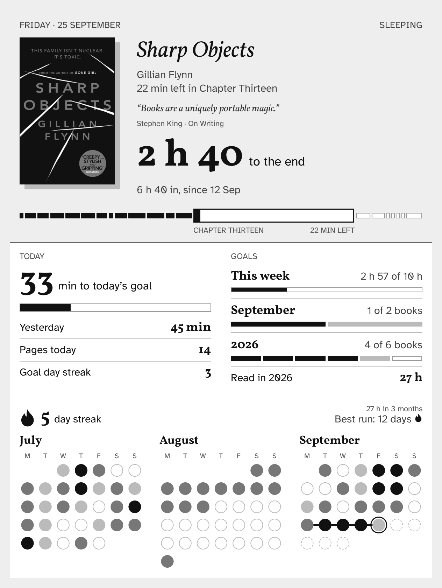
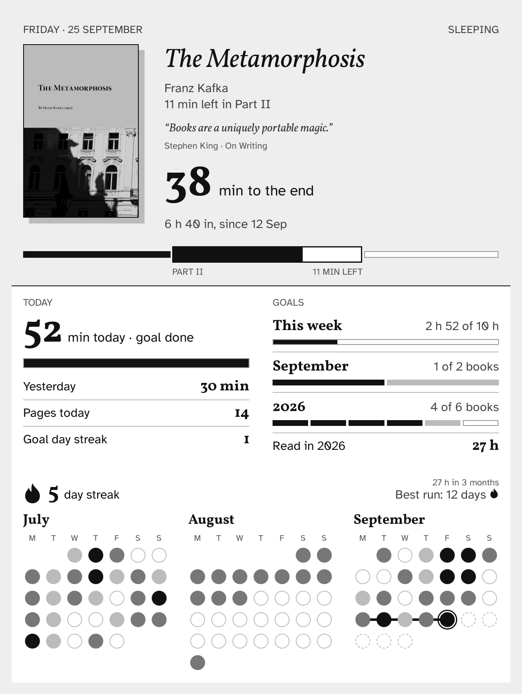
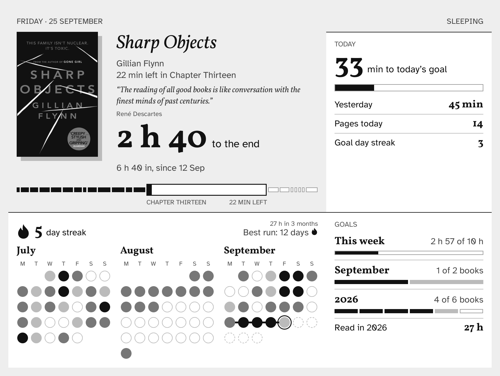

# Coverlet

A [KOReader](https://koreader.rocks) sleep screen that nudges you back to your book. When the e-reader sleeps, it shows what you're reading, how close you are to the end of the chapter, today against your reading goal, and your streak over the last three months.

<p>
  
  
</p>

Built for slow readers. Nothing on it compares your speed, a day off reads as a rest day, and any page counts as a reading day.

## What's on it

- **The book:** its cover at its own proportions, the time left in the chapter and in the book, and how long you've spent in it so far.
- **A quote about reading,** a different one each time the screen sleeps. There are 93, each checked against its source ([sources](docs/quote-sources.md)).
- **The chapter bar:** the current chapter magnified, the ones before it filled, the ones after outlined.
- **Today:** minutes to your daily goal, yesterday's reading, pages today, and how many days in a row you've met the goal.
- **Goals:** this week's hours, and books finished this month and this year. Books still in progress show in grey after the finished ones.
- **The streak:** a flame that grows with the run and stays an outline until you read today, your best run, and the hours in the three months shown.
- **A calendar** of the last three months, each day shaded by how long you read.

It also has layouts for landscape, no book open, and Reading statistics turned off.



## Install

1. Copy this folder to `koreader/plugins/coverlet.koplugin` on your device and restart KOReader.
2. Turn it on in **Tools → Coverlet → Use as sleep screen**. Turning it off restores the sleep screen you had before.
3. **Tools → Coverlet → Preview** shows it right away; tap to close.

What it needs:

- **KOReader's Reading statistics** turned on. Every number comes from it, so Coverlet tracks nothing new.
- **[Bookshelf](https://github.com/AndyHazz/bookshelf.koplugin)** for goals (optional). Coverlet reads the daily, weekly, monthly and yearly goals you set in Bookshelf's Reading goal, and counts finished books the same way, so the two always agree. Without Bookshelf the goal rows are left out.
- **Fonts** (optional): [Vollkorn](https://fonts.google.com/specimen/Vollkorn) and [Atkinson Hyperlegible](https://fonts.google.com/specimen/Atkinson+Hyperlegible) in your device's font folder. Otherwise it uses KOReader's Noto fonts.

On an ad-supported Kindle, KOReader only draws sleep screens once Amazon's ad screensaver is unloaded (`lipc-set-prop com.lab126.blanket unload ad_screensaver`), and that resets on every reboot.

## Design rules

- Covers are drawn at their own pixels and only ever shrunk to fit. Never stretched or enlarged.
- Everything is drawn in the 16 greys an e-ink screen can show.
- No wording depends on the time of day, and every label reads right at 1 and at many.
- A book counts as finished only when it's marked finished. In progress means at least a tenth read.

## How it works

KOReader's `Screensaver` passes an unknown screen type through its setup untouched. Coverlet registers the type `coverlet` and wraps `Screensaver:show()`: for that type it builds its own widget and hands it to core's `ScreenSaverWidget`, so KOReader closes it on wake like any of its own screens. If drawing ever fails, it falls back to a plain screen instead of leaving the device on a broken one.

| File | Does |
|---|---|
| `main.lua` | The menu and the sleep screen hook. |
| `coverlet/data.lua` | Reads the open book (or the last one), the statistics database, the reading history and Bookshelf's goals into a plain model. |
| `coverlet/screen.lua` | Draws the model. The layout is in 1264×1680 design units, scaled to the real screen. |
| `coverlet/format.lua`, `chain.lua`, `quote.lua` | All the wording, the day and streak maths, the chapter bar's layout and the quote rotation, as pure Lua. |
| `coverlet/quotes.lua` | The quotes. |

When the screen sleeps from the file browser, the book isn't open, so Coverlet keeps a snapshot of the chapter and marks while you read and uses that.

## Tests

```sh
tools/test.sh <koreader-dir> [covers-dir] [out-dir]
```

`<koreader-dir>` is an extracted `koreader-linux` release (arm64 or x86_64). The script needs Docker, and runs two layers in a Debian container:

1. `tests/run.lua`: unit tests for the wording, the day maths, the chapter bar and the quote rules, on KOReader's LuaJIT.
2. `tools/render.lua`: the real KOReader engine, headless. It renders every state in `tools/fixtures.lua` to PNG and fails if any block overlaps another, leaves the screen or runs into its neighbour. It also checks the statistics SQL against a synthetic database, the book counts against synthetic sidecars, and suspends through core's `Screensaver` to test the hook end to end.

`covers-dir` can hold sample covers named after the fixtures (`metamorphosis.png`, `sharp.png`); without it, the fixtures use the typeset cover. With Vollkorn and Atkinson Hyperlegible copied into the build's `fonts` folder, the renders match the device.

## Credits

- [KOReader](https://github.com/koreader/koreader), whose sleep screen and statistics this builds on.
- [Bookshelf](https://github.com/AndyHazz/bookshelf.koplugin) by AndyHazz, for the reading goals.
- Vollkorn by Friedrich Althausen and Atkinson Hyperlegible by the Braille Institute, both under the SIL Open Font License.

## License

[MIT](LICENSE)
